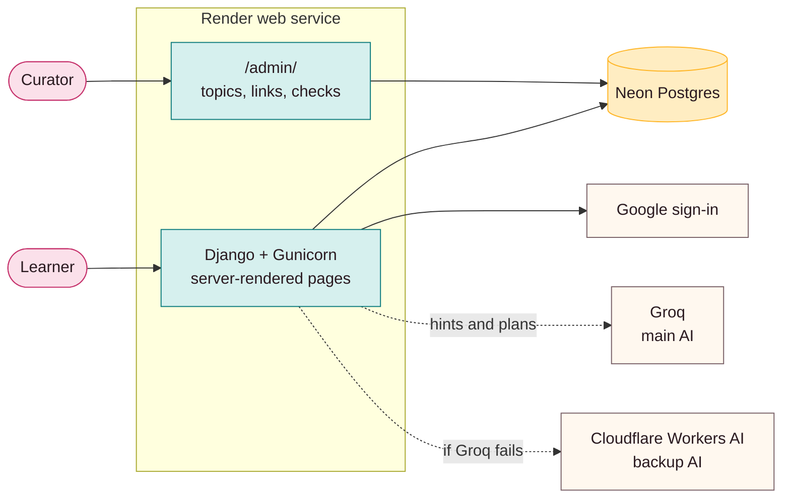
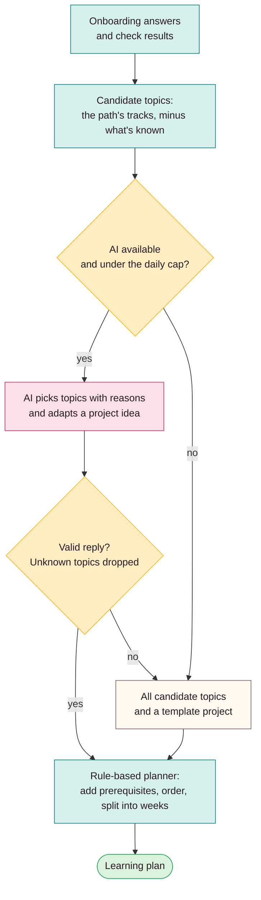
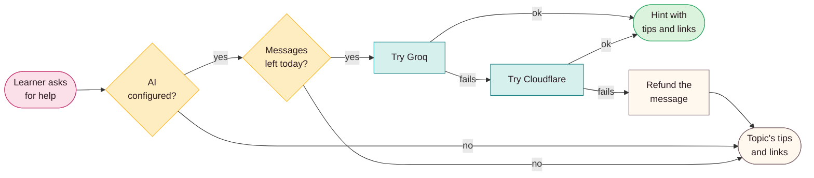
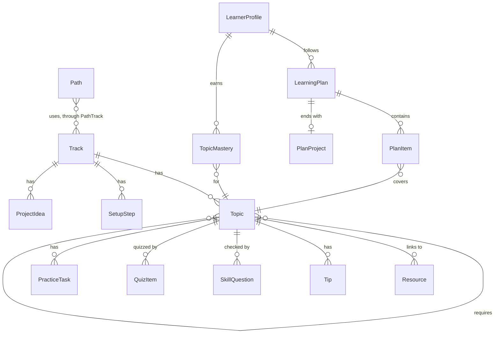

<div align="center">

<a href="https://learnpath-l14m.onrender.com"></a>

<br>

[](https://learnpath-l14m.onrender.com)
[](.python-version)
[](requirements.txt)
[](#tech-stack)
[](LICENSE)

**[How it works](#how-it-works)** · **[Architecture](#architecture)** · **[Run it locally](#run-it-locally)** · **[Curating topics](#curating-topics)** · **[Status](#status)** · **[Contributing](#contributing)**

</div>

## Why CodeAgapay

Beginner programmers get stuck, and there usually isn't a tutor around when it happens. CodeAgapay gives them support at any hour: a plan that starts from what they already know, and hints that keep them thinking instead of handing over the answer.

*Agapay* is Filipino for support. Built by Group 5 (ST2A) with CompSAt at Ateneo de Manila University, and open source so CompSAt can run and extend it after the project ends.

- **Curated, not written.** Like The Odin Project, we don't write tutorials. Each topic points to trusted free resources such as official docs, MDN, freeCodeCamp and W3Schools, then checks understanding.
- **Goals first.** Learners choose what they want to make, and the path decides the languages.
- **Hints, never answers.** The AI helper uses only the current topic's material, and quiz answers never leave the server.
- **Free to run.** Everything sits on free tiers, and the app still works with the AI turned off.

## How it works



1. **Sign in with Google.** No passwords to manage.
2. **Tell us what you want to make.** Learners choose a skill path, such as "Make a website" or "Work with data". Questions come one at a time, are tap-to-answer, and all allow "not sure": a project, experience, topics they've used, time per week, an optional target date and what helps when they're stuck.
3. **Show where you're starting.** A short check runs only on the topics they ticked. Each topic gets a status with its evidence: shown, partly there, to work on, or not checked yet. "I don't know yet" means not checked, never a failure.
4. **Confirm.** A summary shows their answers, the check results and a rough range of weeks, flagged if it misses their date. Any answer can be changed before the plan is built.
5. **Get a plan.** The plan page leads with one next step, then the goal, starting point, time estimate and the project step for each week. AI-written parts are labelled, and learners can report problems to curators.
6. **Learn and review.** Each topic has vetted resources, tips, practice and a short fill-in-the-blank quiz. Passed topics come back for review after a week. After repeated misses, the result page points to other resources and the topics it builds on.
7. **Get help.** The "Need help?" panel steps through three levels of hints in English or Taglish, leaning toward what each learner said helps them.

Paths, edited in admin: Make a website, Automate boring tasks, Work with data, Make games and fun projects, Get ahead in CS class. A path is offered once its first track is active. Tracks: Python, JavaScript, HTML, CSS, Java, SQL.

## Architecture



### How a plan gets built

The AI can only choose from topics curators have added. The rules decide everything else, and they're what runs when the AI is unavailable.



### How a hint gets answered

A learner always gets something useful back. If the AI can't answer, the message isn't counted against their daily limit.



### Data model

The main tables. Curators edit paths, tracks, topics and everything attached to them through admin. Profiles, plans and mastery are learner data.



### Project layout

| Folder | What's in it |
| --- | --- |
| `config/` | Settings, root URLs, WSGI |
| `accounts/` | Learner profile, the first-login redirect, Settings and unsubscribe |
| `content/` | Paths, tracks, topics, resources, checks, the link checker, the AI drafting commands and `drafts/` |
| `diagnose/` | Onboarding, the skill check and scoring (`scoring.py`, `onboarding.py`) |
| `learning/` | Plans, lessons, quizzes, practice and reminders (`planner.py`, `grading.py`, `tailoring.py`, `reminders.py`) |
| `assistant/` | AI providers, the help endpoint and daily caps (`service.py`) |
| `templates/`, `static/` | Server-rendered pages, one stylesheet and small vanilla JS files |
| `fixtures/` | `content.json`, the sample and backup of curated topics |

## Tech stack

| Layer | Choice | Free tier notes |
| --- | --- | --- |
| Framework | Django 5.2, server-rendered templates, vanilla JS | |
| Auth | django-allauth, Google only | No passwords stored |
| Database | Neon Postgres in production, SQLite locally | Neon closes idle connections |
| Hosting | Render with WhiteNoise for static files | Sleeps after 15 idle minutes, so the first visit is slow |
| AI | Groq, with Cloudflare Workers AI as backup | Optional. Both use the `openai` package with a custom base URL |

## Run it locally

You need Python 3.13 and Git.

```bash
git clone https://github.com/r1tsuuu/socsc14-opensource-learnpath.git
cd socsc14-opensource-learnpath
python -m venv .venv
source .venv/bin/activate          # Windows: .venv\Scripts\activate
pip install -r requirements.txt
cp .env.example .env               # fill in the values (see below)
python manage.py migrate
python manage.py loaddata fixtures/content.json
python manage.py createsuperuser
python manage.py runserver
```

Open http://localhost:8000 for the app and http://localhost:8000/admin for curating.

### Environment variables

| Variable | Needed for |
| --- | --- |
| `SECRET_KEY` | Django. Any long random string locally |
| `DEBUG` | `True` locally, `False` in production |
| `ALLOWED_HOSTS`, `CSRF_TRUSTED_ORIGINS` | Production domain |
| `DATABASE_URL` | Production database. Leave blank locally to use SQLite |
| `GOOGLE_CLIENT_ID`, `GOOGLE_CLIENT_SECRET` | Google login |
| `GROQ_API_KEY`, `GROQ_MODEL`, `CF_ACCOUNT_ID`, `CF_API_TOKEN`, `CF_MODEL` | AI helper. Leave blank to turn the AI off |
| `AI_DAILY_LIMIT` | AI hint messages per learner per day (default 20) |
| `GROQ_PLAN_MODEL`, `AI_INTAKE_DAILY_LIMIT` | Model for tailored plans, and AI-tailored plans per learner per day (default 2). Past the cap, the plan is built without AI |
| `EMAIL_HOST`, `EMAIL_PORT`, `EMAIL_HOST_USER`, `EMAIL_HOST_PASSWORD`, `DEFAULT_FROM_EMAIL` | Reminder emails, on the machine that runs `send_reminders`. SMTP with TLS |
| `SITE_URL` | Links in emails. Defaults to the live site; set it only to test emails locally |

Ask a teammate for shared keys. Never commit `.env`.

### Run the tests

There is no CI, so run the tests before you merge. All AI calls are mocked.

```bash
DATABASE_URL="sqlite:///$PWD/db.sqlite3" python manage.py test
```

> [!WARNING]
> Keep the `DATABASE_URL` override if your `.env` points at Neon. Without it, the tests run on the production database server: a separate test database, but far slower (about 8 minutes instead of 8 seconds) and it uses up free compute.

## Curating topics

Tracks, topics, links, tips and quiz questions are all edited at `/admin/`, with no coding. Adding a track is curation work, not new code. Ask a developer for an admin account.

<details>
<summary><strong>Draft topics with AI</strong></summary>

<br>

The AI can draft a topic's checks so curators only review them:

```bash
python manage.py draft_topic html "Page structure" "Text and headings" "Links and images"
```

- One Groq call per topic (needs `GROQ_API_KEY` in `.env`). Each draft has a summary, 2 tips, 2 skill check questions and 4 quiz blanks.
- Titles are added after the track's existing topics, each requiring the one before.
- The AI never writes links, because models make up URLs. Add 2 real links per topic in admin.
- It refuses to write into a live track, so unreviewed drafts never reach learners. Draft into an inactive track, review every topic in admin, then tick **Active**.
- Add `--dry-run` to see a draft without saving it.
- Point `DATABASE_URL` at production only when you mean to draft into it.

</details>

<details>
<summary><strong>Load drafted content</strong></summary>

<br>

`content/drafts/` holds content waiting for review: the HTML and CSS tracks, and a fourth quiz question for each Python topic. Nothing in it reaches the site until someone loads it.

```bash
DATABASE_URL="<neon url>" python manage.py load_drafts content/drafts/html.json
DATABASE_URL="<neon url>" python manage.py load_drafts content/drafts/css.json
```

- It only adds. It finds tracks and topics by slug, skips what's already there, and never changes curated content.
- It refuses to write into a live track. Review every topic in admin, tick **Intro approved** on each one, then tick **Active** on the track.
- Load HTML and CSS before activating either, then run `check_links`.
- The Python questions go straight to learners because Python is live, so read `content/drafts/python_quiz.json` first, then add `--allow-active-track`.

> [!WARNING]
> Don't use `loaddata fixtures/content.json` to add content to production. It overwrites curated topics with the older copy in the file.

</details>

<details>
<summary><strong>Back up curated topics from production</strong></summary>

<br>

```bash
DATABASE_URL="<production database url>" python manage.py dumpdata content --indent 2 > fixtures/content.json
```

</details>

## Regular jobs

Render free has no shell or cron, so someone on the team runs these from a laptop against Neon, once a week. We chose this over a scheduler to keep hosting free and to keep the production database URL out of GitHub. Both are safe to run as often as you like.

<details>
<summary><strong>Check for broken links</strong></summary>

<br>

```bash
DATABASE_URL="<neon url>" python manage.py check_links
```

- Add `--track python` to check one track.
- See the results in admin under **Resources**, using the link status filter.
- **Broken** means a 404 or 410, or the site failing to connect twice in a row. **Check by hand** means the site refused the script or had an error, which often isn't the link's fault.
- Links are never hidden automatically. Fix the link, or untick **Active**.

</details>

<details>
<summary><strong>Send reminder emails</strong></summary>

<br>

```bash
DATABASE_URL="<neon url>" python manage.py send_reminders --dry-run   # who is due, nothing sent
DATABASE_URL="<neon url>" python manage.py send_reminders
```

- Needs the `EMAIL_*` settings. Without `EMAIL_HOST` it refuses to send.
- A learner gets one after 7 days with no activity, then one a week, and none after 3 in a row with no reply. Coming back starts the count again.
- Reminders are opt-in. The plan page asks each learner once, and they can change it in Settings.
- Only learners who said yes, with an unfinished plan or a due review, get one.
- Every email has an unsubscribe link that works without logging in.
- If a send fails, it's retried on the next run.

</details>

## Deploying

`main` deploys to Render automatically.

<details>
<summary><strong>Render and Neon setup</strong></summary>

<br>

- **Render web service** (free, Singapore): build command `./build.sh`, start command `gunicorn config.wsgi:application`. Python comes from `.python-version`.
- **Neon Postgres** (free, Singapore): put its connection string in Render as `DATABASE_URL`.
- Set `SECRET_KEY`, `DEBUG=False`, `GOOGLE_CLIENT_ID` and `GOOGLE_CLIENT_SECRET` in Render. The Render hostname is added to `ALLOWED_HOSTS` and `CSRF_TRUSTED_ORIGINS` automatically; add custom domains yourself.
- Render free has no shell. Run admin commands from your laptop against Neon:

```bash
DATABASE_URL="<neon url>" python manage.py createsuperuser
DATABASE_URL="<neon url>" python manage.py loaddata fixtures/content.json
```

</details>

<details>
<summary><strong>Google login setup</strong></summary>

<br>

1. In Google Cloud console, create an OAuth client (type: Web application).
2. Add these authorized redirect URIs:
   - `http://localhost:8000/accounts/google/login/callback/`
   - `https://learnpath-l14m.onrender.com/accounts/google/login/callback/`
3. Put the client ID and secret in `.env` locally and in Render's environment.
4. Publish the OAuth consent screen to production, or only listed test users can log in.

The credentials live in settings only. Don't add a Google "Social application" in admin; allauth then finds two and login crashes.

</details>

## Status

| Part | Status |
| --- | --- |
| Setup and deployment | ✅ Live on Render with Neon Postgres |
| Curation admin | ✅ Done, with sample Python topics in `fixtures/content.json` |
| Google login | ✅ Done |
| Onboarding and skill check | ✅ Guided flow at `/start/`, with the form at `/about/` as fallback |
| Learning plan | ✅ Done |
| Lessons, setup guides and quizzes | ✅ Done |
| AI helper | ✅ Help panel on lesson, practice and quiz pages |
| Practice tasks | ✅ Done, with AI feedback. No code editor |
| AI drafting commands | ✅ `draft_topic`, `draft_intro` and `draft_practice` |
| HTML and CSS tracks | 🟡 Drafted in `content/drafts/`. To do: review, load and activate. No practice tasks yet |
| JavaScript, SQL and Java tracks | ⬜ Not started |
| Finish screen and Settings | ✅ Done, at `/plan/finished/` and `/settings/` |
| Reminder emails | 🟡 `send_reminders` is done and opt-in. To do: choose the sending email account |
| Broken-link check | ✅ `check_links`, with results in admin. Run by hand |
| User testing and handover | 🟡 In progress |

Update this table as parts are finished, and list known bugs below.

### Known issues

- Quizzes pass at 70%. With 2 or 3 items per topic, every answer must be right (2 of 3 is 67%). The sample Python topics have 3, so write 4 or more if one mistake should still pass. A fourth question for each is ready in `content/drafts/python_quiz.json`.
- Reminders and link checks don't run by themselves. Someone runs them weekly by hand (see [Regular jobs](#regular-jobs)).
- Opening a lesson isn't recorded, so a learner who only reads counts as away for reminders.
- The link check can't see a page that says "not found" but answers 200.
- The quick check only covers a path's first track. Later tracks start as "not checked yet" and can be skipped by passing each topic's quiz.
- Reviews come back on a fixed 7-day rule, not a spaced-repetition schedule.
- Onboarding answers live in the session until confirmed, so they survive a refresh but not a new device.
- Marking a topic done by hand records it as known (source "manual"), so a rebuilt plan skips it. Undo reverses that.

## Contributing

1. Create a branch from `main` named `<your-name>/<feature>`.
2. Run the tests, then open a pull request. One teammate reviews it before merging.
3. `main` deploys to the live site automatically, so keep it working.

Keep views thin and put logic in testable modules such as `scoring.py`, `planner.py` and `grading.py`. Mock every external call in tests.

## Team

| Name | Role |
| --- | --- |
| Neil Biason | Critical path build, deployment |
| Christian | Frontend, integration, QA |
| Abdul Wahab | Testing, automation, handover, CompSAt contact |
| Eliza Casey | Curation lead |

## License

MIT. See [`LICENSE`](LICENSE).
