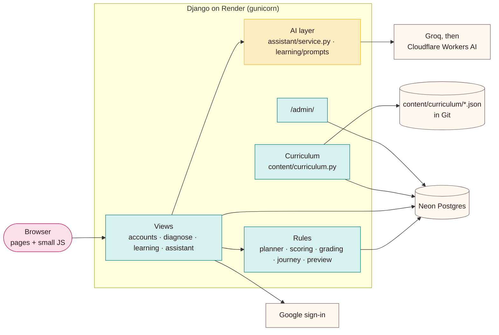

# Architecture

CodeAgapay is one Django app (a modular monolith) on one Render web service, with one Postgres database. Pages are rendered on the server; the browser runs a few small vanilla JS files. The browser never talks to the AI provider or the database: everything goes through Django views.

## The picture

## Layers

| Layer | Where | Rule |
| --- | --- | --- |
| UI | `templates/`, `static/css/main.css`, `static/js/*.js` | No logic in templates beyond display. JS only enhances: every page works without it, and AI text is only ever set with `textContent` |
| Views | `*/views.py`, `learning/ai_views.py` | Thin: read and validate the request, call the rules, redirect after every POST, use Django messages for feedback. Every learner object is fetched through `request.user` |
| Rules | `learning/planner.py`, `diagnose/scoring.py`, `learning/grading.py`, `learning/journey.py`, `learning/preview.py`, `learning/rewards.py` | Pure, deterministic and unit-tested. No AI calls |
| Data | `*/models.py` | Progress is computed from statuses, never stored. Constraints in the database: one active plan per learner and track, one mastery row per learner and topic, one usage row per learner and day |
| AI | `assistant/service.py` (providers, caps, hints), `learning/outline.py`, `learning/lessons.py`, `learning/tailoring.py`, `diagnose/onboarding.py`, `learning/prompts/*.md` | Every AI call goes through `assistant/service.py`, which enforces daily caps on the server and falls back when providers fail. See [AI.md](AI.md) |
| Curriculum | `content/curriculum/*.json`, `content/curriculum.py` | Files in Git are the source of truth; `import_curriculum` loads them. See [CURRICULUM.md](CURRICULUM.md) |
| Auth | django-allauth, `LoginRequiredMiddleware` | Every page needs a login unless marked `@login_not_required` (landing, health, unsubscribe) |
| Ops | `config/health.py`, `config/logging.py`, `scripts/check.sh`, `build.sh` | `/health/` for monitors; JSON logs with secrets redacted |

## Main flows

**Sign-up to plan.** `home` → `welcome` → `/start/` (guided onboarding in `diagnose/onboarding.py`, answers in the session) → quick check on claimed topics (`diagnose/scoring.py`) → review → plan. With `AI_PLANS` off (or the AI unavailable) the plan comes from `learning/planner.build_plan` over curated topics, optionally with AI-picked topics and reasons from `learning/tailoring.py`; the planner still adds prerequisites, orders and splits weeks. With `AI_PLANS` on, `learning/outline.py` writes an outline and lessons are written on first open.

**Studying a topic.** `/learn/<topic>/` (resources, tips, project step) → `/practice/` (coding panel, AI or checklist feedback) → `/quiz/` (graded in `learning/grading.py`; a pass marks the item done and the topic demonstrated).

**Getting help.** The help panel posts JSON to `/help/ask/`. The view validates every field, `assistant/service.py` reserves a message against the daily cap, builds a bounded prompt, tries Groq then Cloudflare, and on any failure returns the action's curated fallback plus the topic's tips and links (the message is given back). Feedback posts to `/help/feedback/`.

**Plan changes.** Mark done, skip, undo, Later (`planner.defer_item`), change pace (`planner.repace_plan`), pause (`LearnerProfile.paused_at`) and change answers (a rebuilt plan skips topics already shown). All are POSTs scoped to the learner's own active plan.

## Data model

See the diagram in the [README](../README.md#data-model). Additions in the handover work:

- `CurriculumRelease`: one row per curriculum import (version, checksum, summary).
- `LearningPlan.curriculum_version`: the release a plan was built from.
- `PlanItem.topic` is `PROTECT`: a topic in any plan can't be deleted, so old plans keep rendering.
- `LearnerProfile.paused_at`, `LearnerProfile.explain_language`.
- `HelpFeedback`: thumbs and reports on Agapay replies, without the question or reply text.

## Module ownership

Suggested owners after handover. One person can hold several roles.

| Area | Modules | Role |
| --- | --- | --- |
| Curriculum | `content/curriculum/`, `content/curriculum.py`, `content/linkcheck.py`, admin | Curators, plus one developer for imports |
| Onboarding and plans | `diagnose/`, `learning/planner.py`, `journey.py`, `preview.py`, `rewards.py`, `reminders.py` | Backend developer |
| AI | `assistant/`, `learning/outline.py`, `lessons.py`, `tailoring.py`, `ai_plan.py`, `ai_views.py`, `learning/prompts/` | AI owner (also watches Groq usage) |
| Frontend | `templates/`, `static/` | Frontend developer (keeps the Figma tokens in `main.css` in sync) |
| Ops | `config/`, `build.sh`, `gunicorn.conf.py`, `scripts/` | Whoever holds the Render and Neon accounts |

## Constraints that shaped it

- **Zero cost.** Free tiers only: Render (sleeps after 15 minutes), Neon, Groq and Cloudflare free quotas. No shell or cron on Render, and SMTP is blocked there, so reminders and link checks run from a laptop.
- **Works with the AI off.** Every AI feature has a rule-based fallback.
- **Curated, not written.** The team links to trusted free resources and writes checks; it does not write tutorials.
